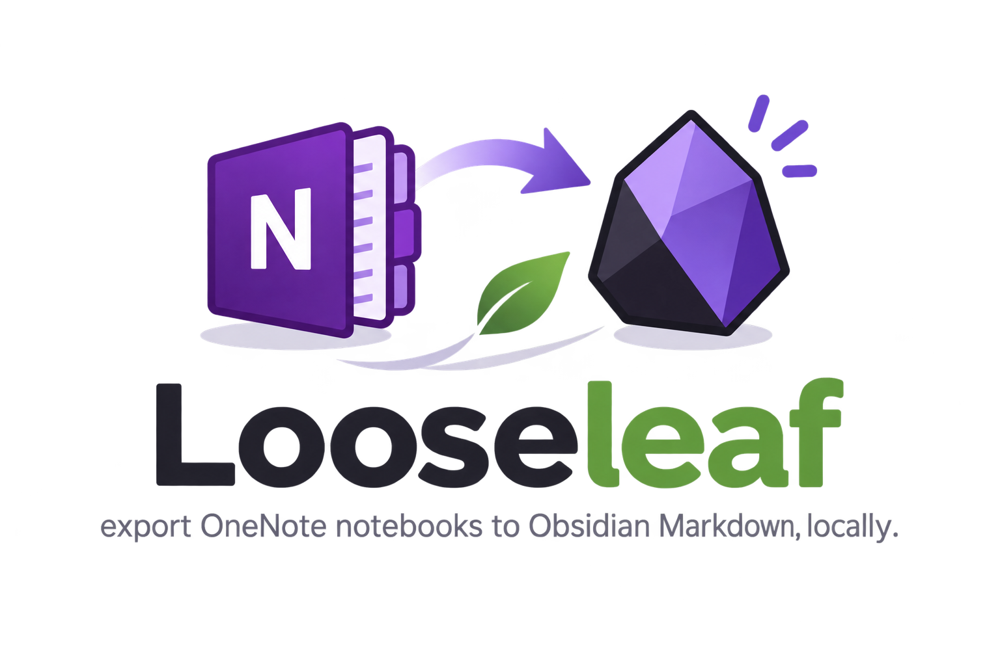

# Looseleaf



**Export OneNote notebooks to Obsidian-ready Markdown, locally.** Nothing is uploaded to OneDrive or any other cloud service.

> [!WARNING]
> **Status: pre-alpha.** The architecture and behaviour are documented in [docs/DESIGN.md](docs/DESIGN.md).
>
> - **Done:** stage 2, `Update-LooseleafVault`, which builds the vault from a work folder. It's tested with Pester and validated on 502 real pages ([§12.3](docs/DESIGN.md#123-stage-2-results-2026-11-08)).
> - **Not yet built:** stage 1 (`Export-LooseleafNotebook`, the OneNote export that writes the work folder) and `Test-LooseleafEnvironment`. Until stage 1 exists, stage 2 has no real input apart from hand-made test manifests.

## Why Looseleaf?

| Tool | Why it wasn't enough |
| --- | --- |
| [Obsidian Importer](https://github.com/obsidianmd/obsidian-importer) | Needs every notebook uploaded to OneDrive (it uses the Microsoft Graph cloud API), and it crashed on large notebooks. |
| [ConvertOneNote2MarkDown](https://github.com/theohbrothers/ConvertOneNote2MarkDown) | Works locally, but its image naming, file-name handling and page order needed fixes for Obsidian. Those fixes (ON2MD) were a patch layered over upstream code, with no tests or history. |

Looseleaf is a standalone rewrite of those fixes as a tool you can maintain, with documentation, tests and version control.

## How it works

Looseleaf runs in two separate stages:

```text
 OneNote desktop ──COM──▶ Stage 1: Export ──▶ work folder ──▶ Stage 2: Build ──pandoc──▶ Obsidian vault
 (must be open)            (needs OneNote)     manifest.json     (no OneNote needed,
                                               *.docx            re-run any time)
                                               attachments/
```

- **Stage 1, Export** (`Export-LooseleafNotebook`): reads the notebook hierarchy and page order, publishes each page to `.docx`, copies attachments and writes `manifest.json`. Unchanged pages are skipped, so a large notebook that is interrupted can be resumed.
- **Stage 2, Build** (`Update-LooseleafVault`): converts the `.docx` files to Markdown with pandoc, names images and orders pages, and writes the vault. It never talks to OneNote, so you can change settings and rebuild at any time (about 4–5 minutes for 500 pages).

## Planned features

- Runs entirely on your machine, with no cloud services
- Resumable export: pages that haven't changed are skipped
- OneNote page order preserved in the vault through `NN-` prefixes
- Short image names (e.g. `Recon-Passive-DNS-01.png`), unique across the notebook's shared `media/` folder and stable between rebuilds
- YAML front matter with the page's created/modified dates and its OneNote ID
- File names that work on both NTFS and in Obsidian links (`[ ] # ^ |`, reserved device names, trailing dots, path length)
- Preflight checks: privilege mismatch, unsupported OneNote edition, locked sections, collapsed paragraphs, ink
- Clean Markdown from typical OneNote content: single-cell "box" tables become code blocks or callouts, text in monospace fonts becomes code, typed bullets become real lists, and indentation no longer turns into quotes. Placeholders such as `<target_ip>` stay visible.
- Notes you edit in Obsidian after export are not overwritten on rebuild
- Optional automatic expansion of collapsed paragraphs (replaces the Onetastic macro)
- Per-page failure summary and a non-zero exit code when something fails
- `-WhatIf` support on every step that changes files

## Requirements

| Requirement | Notes |
| --- | --- |
| Windows 10/11 | OneNote's COM automation API only exists on Windows. |
| OneNote desktop (2016 or Microsoft 365) | *OneNote for Windows 10* (the Store app) has **no** COM API and is not supported. |
| Windows PowerShell 5.1 | The baseline. PowerShell 7.x is supported on a best-effort basis. |
| [pandoc](https://pandoc.org/installing.html) 3.x | Must be on `PATH`. Developed against 3.9. |

**Administrator rights are not required.** PowerShell and OneNote just need to run at the *same* privilege level. Run both normally. See [docs/TROUBLESHOOTING.md](docs/TROUBLESHOOTING.md).

## Quick start (planned)

```powershell
cd Looseleaf
Import-Module .\src\Looseleaf

Copy-Item .\looseleaf.config.example.psd1 .\looseleaf.config.psd1   # once, then edit

Test-LooseleafEnvironment -ConfigPath .\looseleaf.config.psd1   # preflight, read-only (planned)
Export-LooseleafNotebook  -ConfigPath .\looseleaf.config.psd1   # stage 1, OneNote open (planned)
Update-LooseleafVault     -ConfigPath .\looseleaf.config.psd1   # stage 2 (available; -WhatIf to preview)
```

## Documentation

| Document | Contents |
| --- | --- |
| [docs/DESIGN.md](docs/DESIGN.md) | Architecture, manifest format, output layout, naming rules, error handling, and lessons from ON2MD |
| [docs/CONFIGURATION.md](docs/CONFIGURATION.md) | Every configuration setting |
| [docs/TROUBLESHOOTING.md](docs/TROUBLESHOOTING.md) | Privileges, COM errors, collapsed paragraphs, locked sections, ink, antivirus, long paths |
| [docs/TEST-NOTEBOOK.md](docs/TEST-NOTEBOOK.md) | Checklist for building the stage 1 test notebook |
| [CHANGELOG.md](CHANGELOG.md) | Release history |

## Project layout

```text
Looseleaf/
├── README.md
├── CHANGELOG.md
├── LICENSE                         GPL-3.0
├── looseleaf.config.example.psd1   configuration template
├── PSScriptAnalyzerSettings.psd1   optional lint rules (only if you have PSScriptAnalyzer)
├── docs/                           design and user documentation
├── src/Looseleaf/                  PowerShell module
│   ├── Looseleaf.psd1              module manifest
│   ├── Looseleaf.psm1              loader
│   ├── Public/                     exported commands (one per file)
│   ├── Private/                    internal helpers (LL prefix)
│   └── filters/                    pandoc Lua filters (looseleaf.lua)
├── tools/                          development tools (Invoke-LLPrototype.ps1)
└── tests/                          Pester tests (built-in Pester 3.4)
    └── fixtures/                   sample .docx files and manifests
```

## Development

**Try the conversion core** on existing OneNote `.docx` files (for example an old ConvertOneNote2MarkDown `docx/` cache):

```powershell
.\tools\Invoke-LLPrototype.ps1 -DocxPath <folder with .docx> -OutputPath $env:TEMP\looseleaf-proto -Limit 20
```

- **No extra dependencies.** Using Looseleaf needs only Windows PowerShell 5.1, OneNote desktop and pandoc. Development needs nothing more.
- **Tests:** written for **Pester 3.4.0, which ships with Windows 10/11**, so nothing needs installing. They also run on Pester 4. Run them in Windows PowerShell: `powershell -NoProfile -Command "Invoke-Pester .\tests"`. Stage 2 and all naming logic are tested without OneNote; the build tests need pandoc.
- **Lint (optional):** if you have [PSScriptAnalyzer](https://github.com/PowerShell/PSScriptAnalyzer) installed: `Invoke-ScriptAnalyzer -Path .\src -Recurse -Settings .\PSScriptAnalyzerSettings.psd1`. It isn't required.
- **Conventions:**
  - Public commands use approved verbs and the `Looseleaf` noun prefix (`Update-LooseleafVault`).
  - Private helpers use the `LL` prefix (`Get-LLSafeFileName`).
  - One public command per file in `Public/`, and the file name is the command name, because the loader exports by file name. Files in `Private/` are named after their main function and may also hold its small helpers.
  - PowerShell files are UTF-8 **with BOM** and CRLF line endings, so Windows PowerShell 5.1 reads them correctly. Markdown is UTF-8 with LF. See [.editorconfig](.editorconfig) and [.gitattributes](.gitattributes).
  - Personal files (`looseleaf.config.psd1`, logs, work folders) are git-ignored.

## Acknowledgements

Looseleaf is inspired by [**ConvertOneNote2MarkDown**](https://github.com/theohbrothers/ConvertOneNote2MarkDown) by The Oh Brothers and contributors. The two-step approach (OneNote → Word → pandoc) and several of the known issues documented here come from that project. ON2MD, Looseleaf's predecessor, wrapped upstream commit [`2fed7c9`](https://github.com/theohbrothers/ConvertOneNote2MarkDown/commit/2fed7c9) (2024-03-16).

## License

Copyright © 2026 z3lat0r

Looseleaf is free software, released under the **GNU General Public License v3.0**, the same license as ConvertOneNote2MarkDown. See [LICENSE](LICENSE).
